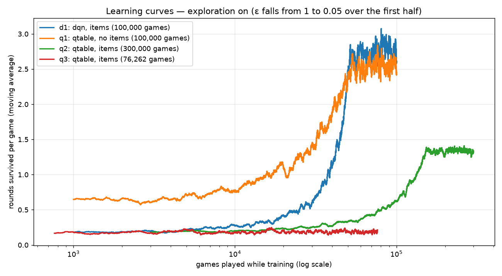
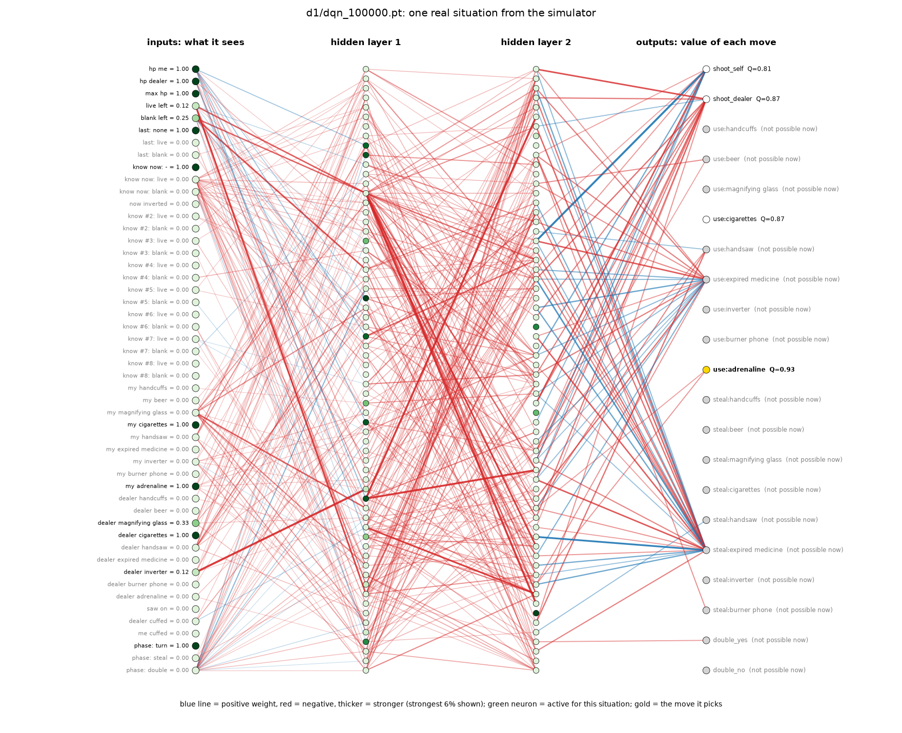
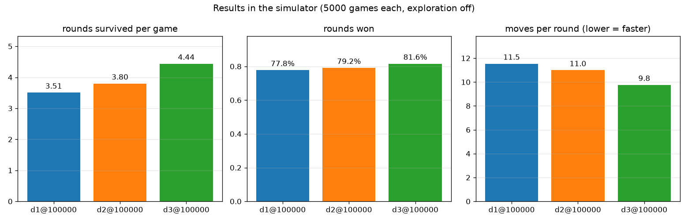
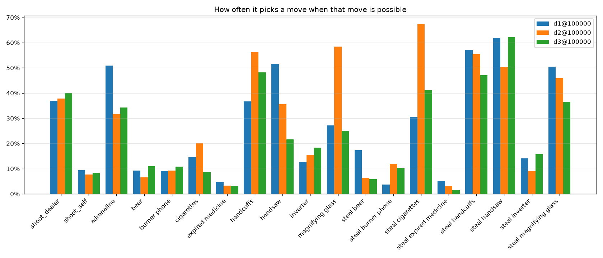
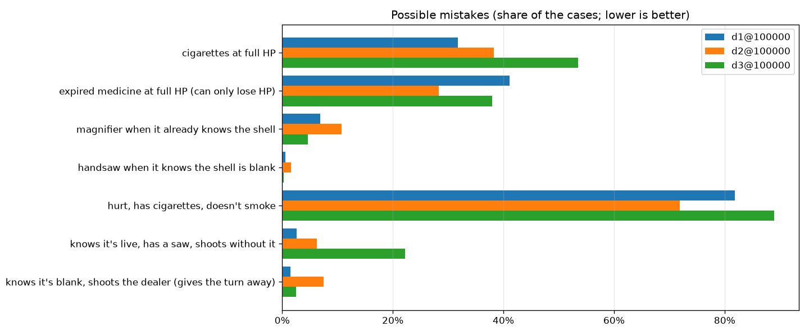
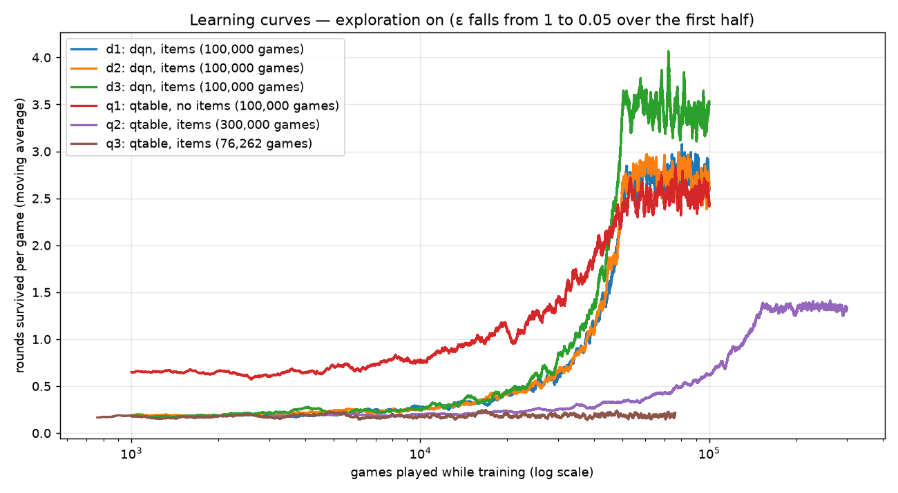
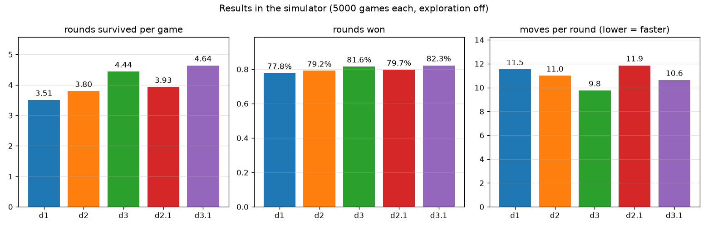
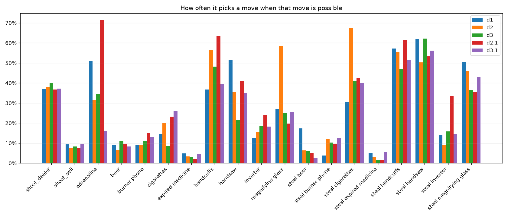
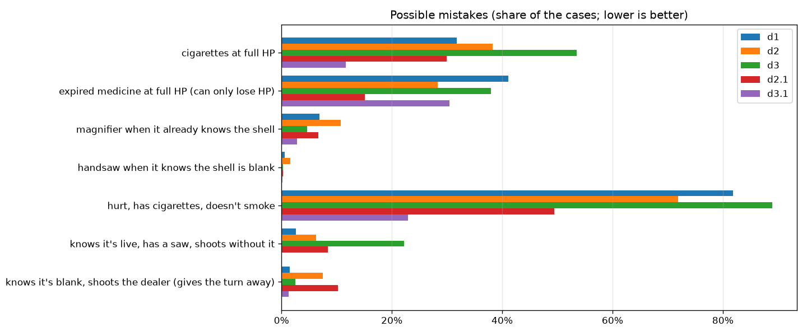
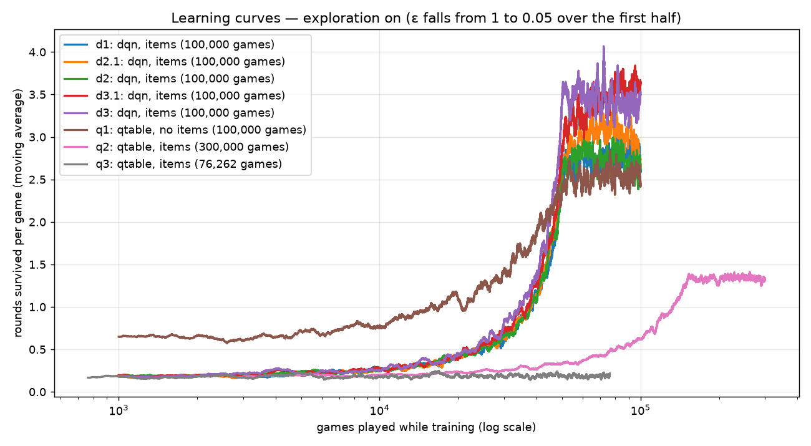

# Progress log — versions of the player

Each version is a git tag (`git checkout <tag>` shows the code as it was) and its trained checkpoints are
kept in `runs/archive/<tag>/` (local only, git-ignored). Numbers: simulator, 10 000 games, exploration off.

| tag | date | what | rounds/game | round win rate |
|---|---|---|---|---|
| — | 2026-10-23 | random player (baseline) | 0.64 | 39.1% |
| `v0.1-qtable-no-items` | 2026-10-23 | sim v1 without items, Q-table, 100k games in 17 s | 2.73 | 73.2% |
| — | 2026-10-23 | random player, **full rules with items** (sim v2) | 0.185 | 15.6% |
| `v0.2-qtable-items` | 2026-10-23 | sim v2 (items, dealer items), Q-table on HP + shells, 300k games in 219 s | 1.52 | 60.4% |
| `v0.3-dqn` | 2026-10-23 | sim v2, **DQN** (50 → 64 → 64 → 21), 100k games in 32 min | 3.56 | 78.1% |
| `v0.4-reward-shaping` | 2026-10-23 | DQN d2: + HP potential (safe shaping) | 3.79 | 79.1% |
| `v0.4-reward-shaping` | 2026-10-23 | DQN d3 (Akel's reward): −0.1 per HP lost, −0.02 per action | 4.28 | 81.1% |
| `v0.5-event-rewards` | 2026-10-23 | DQN d2.1: −0.1 per HP lost, +0.1 per dealer HP hit, +0.1 per HP healed | 3.93* | 79.7%* |
| `v0.5-event-rewards` | 2026-10-23 | DQN **d3.1**: d2.1 + −0.02 per item used/stolen | **4.64*** | **82.3%*** |

## v0.1-qtable-no-items
- Simulator: rounds, HP 2–4, loads 2–8, the dealer's item-free logic, and an "unshuffled loads" quirk that
  turned out to be wrong (removed in v2; see docs/sim-rules.md → Corrections).
- Agent sees HP, live/blank left, the last fired shell. 669 states.
- Learning curve (rounds/game per tenth of training): 0.71 0.93 1.25 1.63 2.19 2.51 2.52 2.46 2.53 2.53.
- Checkpoints: @100 0.83, @1 000 1.94, @10 000 2.62, @100 000 2.73.

## v0.2-qtable-items
- Sim v2: 5 load slots per round, item caps from the game's scene data, all 9 items for both sides,
  adrenaline steals, the dealer's item rules in draw order. Random player 0.185 rounds/game — the random
  test bot on the real game got 0.18.
- Q-table on the basic state (HP + shells; items only as available moves), 300k games, 219 s:
  learning curve 0.22 0.32 0.47 0.70 1.06 1.33 1.33 1.35 1.35 1.32; checkpoints @10k 0.86, @100k 1.51,
  @300k 1.52 rounds/game (60.4% rounds won).
- What it learned to use when available: magnifier 42%, cigarettes 33%, adrenaline 26%, beer 19%,
  inverter 15%; steals cigarettes 61% and magnifier 58%; shoots the dealer 42%, itself 4%; always doubles.
- Q-table on the **full** state (all items, cuffs, saw, phone knowledge): stopped at 76k games — 705 844
  different states (≈ 10 new per game), ~2.5 GB RAM, plays like random (0.19). The table can't cover it →
  the next agent is a neural network (DQN) that generalises between similar states.
- Q-table without items retrained on the corrected rules: 2.72 rounds/game, 73.1%.

## v0.3-dqn
- Agent: a neural network (PyTorch, CPU). 50 inputs (everything it observes, only scaled), two hidden
  layers of 64, 21 outputs = value of each move; replay memory, target network, Double-DQN, illegal moves
  masked. Same reward as the table: 1 per round won.
- 100k games, 32 min (2.9 M moves). Learning curve: 0.22 0.33 0.52 0.88 1.70 2.67 2.71 2.75 2.82 2.73.
- Checkpoints (5 000 games each, exploration off): @1 000 0.67, @10 000 1.63, @100 000 **3.56 rounds/game,
  78.1% rounds won, best game 35 rounds** — better than the Q-table even in the easier no-item game (2.72).
- Uses when available: handsaw 52%, adrenaline 51% (steals saw 61%, cuffs 58%, magnifier 49%), handcuffs
  37%, magnifier 27%; shoots the dealer 37%, itself 9%; always doubles.
- Money (not trained for it): it never takes the prize. Had it stopped after the first cycle: 49% × first
  prize; after the second: 23% × 2 = 0.47 × first prize.
- Pictures: `docs/img/v0.3-learning-curves.png`, `docs/img/v0.3-network-d1.png`
  (`python -m player.buckshot.viz curves|network <checkpoint>`); live: `tensorboard --logdir runs`.

## v0.4-reward-shaping (Akel's experiment) + overlay v1
Same network, simulator and seed as d1; only the reward changes (`train.py --shaping`).
| run | reward on top of +1 per round won | rounds/game | rounds won | moves per round |
|---|---|---|---|---|
| d1 | — | 3.56 | 78.1% | 11.5 |
| d2 | + 0.1 × change of (my HP − dealer HP) / max HP (potential-based) | 3.79 | 79.1% | 11.0 |
| d3 | − 0.1 per HP lost, − 0.02 per action | **4.28** | **81.1%** | **9.8** |
(5 000 games, exploration off; moves per round from the replays.)

Why d3 wins (from the replays, `reports/replays/*/stats.json`): it is **faster** — 9.8 moves per round
instead of 11.5, so the dealer gets fewer turns to draw items and hit back — and the HP penalty arrives
on the very move that lost HP. It is *not* tidier with items: it wastes cigarettes at full HP more often
(53% vs 32%), and the speed cost makes it skip the saw on a known live shell 22% of the time (d1 3%).
Learning curves (per tenth): d3 0.23 0.35 0.60 1.08 2.24 3.51 3.46 3.43 3.41 3.39.

Overlay v1 works on the lab copy: hint mode and play mode (see docs/overlay-design.md). First real games
of d1 through it: 3 games, 1.33 rounds/game (too few to judge; Akel saw it skip cigarettes and beer — d1
also rarely uses them in the simulator: beer 9%, cigarettes 15% of the time they are possible). Every live
decision is now logged to `reports/live_thoughts/` and checked by `python -m player.buckshot.livecheck`.

## v0.5-event-rewards (Akel's d2.1 and d3.1)
Same network, simulator and seed; reward per event (`train.py --shaping hp_events | hp_events_items`).
Numbers from the replays (5 000 games, seed 7, exploration off — rows marked * above; d1–d3 on the same
replays: 3.51 / 3.80 / 4.44).
| run | rounds/game | rounds won | moves/round | cigarettes at full HP | hurt, has cigarettes, doesn't smoke | knows live + has saw, shoots without |
|---|---|---|---|---|---|---|
| d1 | 3.51 | 77.8% | 11.5 | 32% | 82% | 3% |
| d2 | 3.80 | 79.2% | 11.0 | 38% | 72% | 6% |
| d3 | 4.44 | 81.6% | 9.8 | 53% | 89% | 22% |
| d2.1 | 3.93 | 79.7% | 11.9 | 30% | 49% | 8% |
| **d3.1** | **4.64** | **82.3%** | 10.6 | **12%** | **23%** | **0%** |

d3.1 is the best so far **and** the cleanest: the heal bonus teaches it to smoke when hurt (23% skipped vs
82–89%), the item cost stops it smoking at full HP (12%), and with no cost per shot it never skips the
saw on a known live shell. Still left: expired medicine at full HP (30%).

## Real game: d3.1 through the overlay (2026-10-23, ×10)
- Started with one command (`python -m player.buckshot.launch …`, see docs/how-to-run.md).
- `livecheck` found phantom items: the game's own item counters (`amount_player`) go wrong after an
  adrenaline steal, so in 8 of 44 decisions the agent "had" items that were no longer on the table. Fixed:
  the bridge now counts the items lying on the table. After the fix: 151 decisions, no reading problems.
- Games: before the fix 1, 1 rounds survived; after the fix 0, **5, 5** (mean 3.33; the simulator says
  4.64 — only 3 games, too few to compare yet).
- Magnifier: it uses it in 23% of the turns it has one on the real game and 25% in the simulator — its
  style, not a reading error.

## v4.0 design → d4.1 (built 2026-10-23, not trained yet)
Agreed with Akel: tell the agent what is clearly good or bad **by consequences**, never which move to make.
| event | reward |
|---|---|
| round won | +1 |
| died | **−1** |
| HP inside the round | + 0.1 × change of (my HP − dealer HP): damage, healing, medicine of both sides |
| learned a shell it couldn't know or work out (magnifier, phone) | +0.02 |
| item with no effect: healing at full HP, magnifier on a known/deducible shell, cuffs on the last shell, saw on a 1-HP dealer | −0.05 |
| useful item, steal | 0 |
| later rewards | × 0.99 per move (γ) |
Rejected on purpose: −10 "critical mistake" + stopping the game (we'd be deciding what's critical; it
drowns the small signals), a risk penalty for self-shots (it bakes a "> 75% blank" rule into the reward),
+0.05 for a known blank at yourself (redundant, and a loophole next to the inverter), items left at death.
Training: n-step = 3 (a plan's payoff reaches its first move sooner). Observation v2: + the order of shells
out this load, + the dealer's item uses this load (both public). Run:
`python -m player.buckshot.train --games 300000 --run d4.1 --items --agent dqn --shaping v4 --obs 2 --gamma 0.99 --n-step 3`
Report: `replay` now has a full mistake board and an inverter-tactic detector. Baseline d3.1 (3 000 games):
expired medicine at 1 HP 22%, saw on a 1-HP dealer 23%, could steal the saw on a known live 84% skipped;
tactic "only lives + inverter": 601 chances, inverted 64×, then shot itself 38×.
Not yet: the bridge doesn't report the two new observation fields (live play of d4.x would see them empty).
